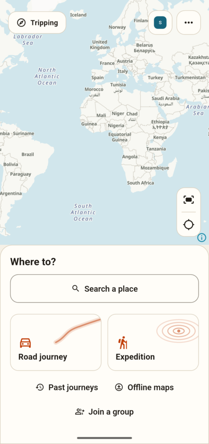
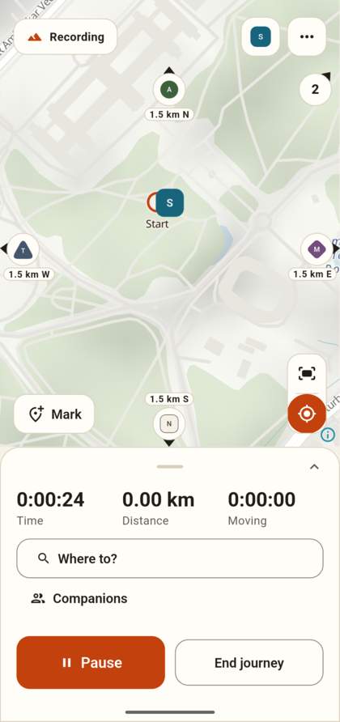
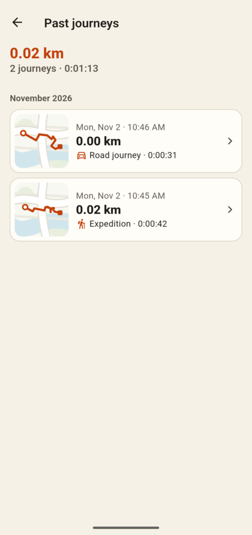
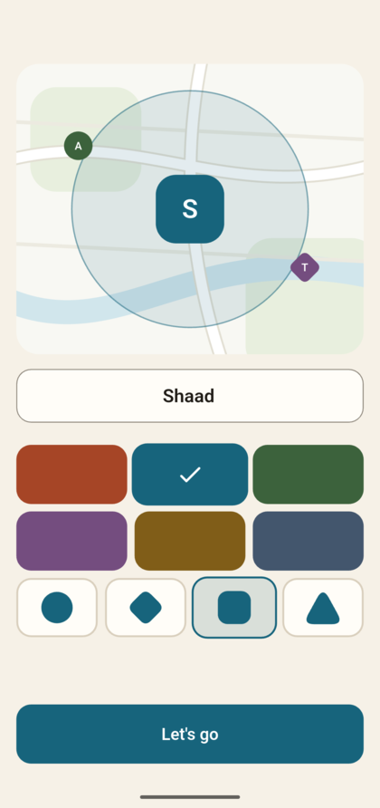
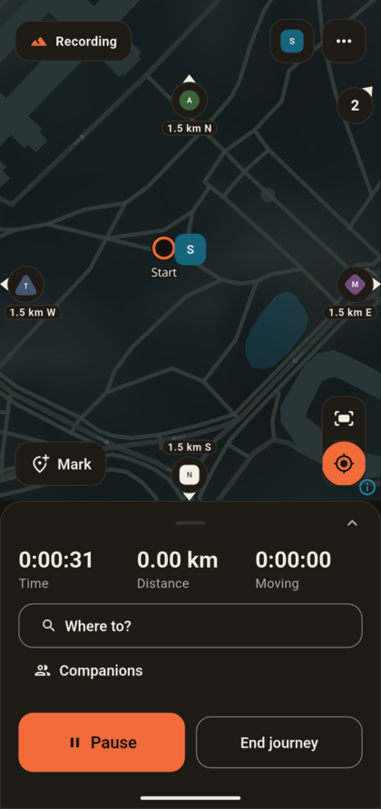
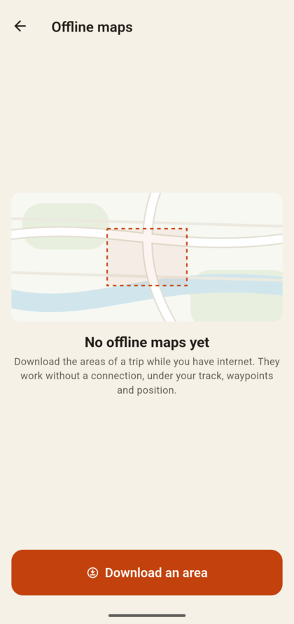
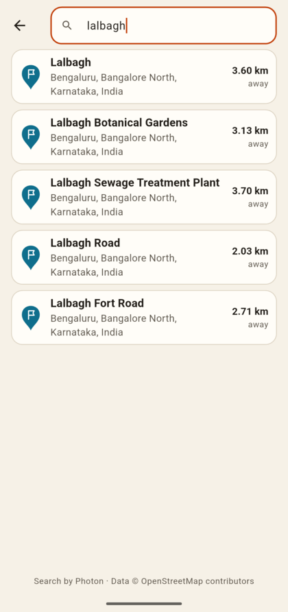
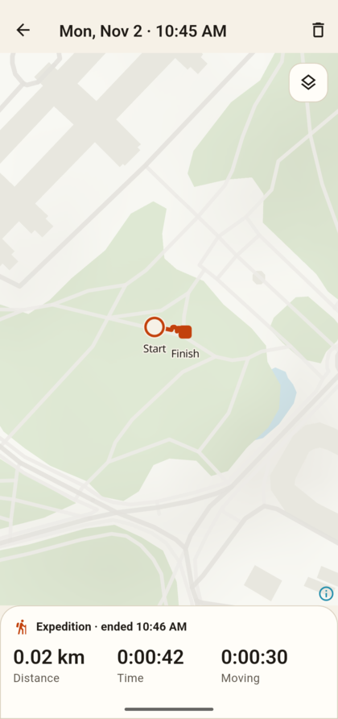
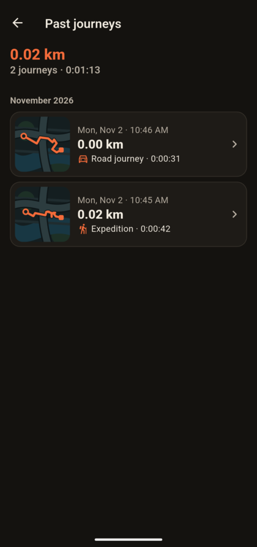
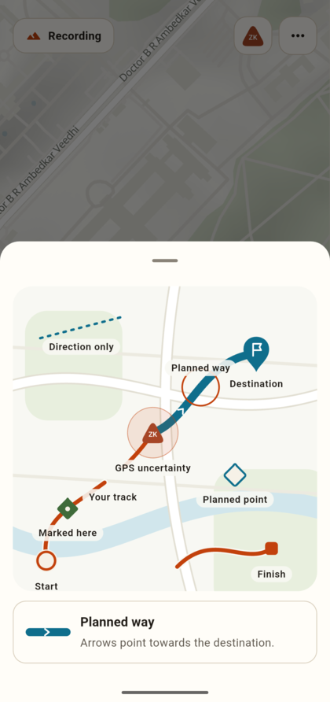

# Tripping

**Go far. Stay together.**

A rider stops for fuel. A car misses a turn. A friend falls behind on the
trail. Before long, the trip becomes a round of “Where are you?” calls.

A shared destination doesn’t tell you where everyone is.

Tripping brings your route, your recorded path and your group onto one map.
Take the detour. Stop for the view. Travel at your own pace, with a way to
keep track of one another.

<p align="center">
  
  &nbsp;
  
  &nbsp;
  
</p>

## Show up as yourself

Pick a name, a colour and a shape. That marker is how you appear on
everyone’s map, so you can tell the group apart at a glance, even in a
crowd of dots.

<p align="center">
  
</p>

## Give everyone room to travel

**On the road,** a stop shouldn’t leave the group guessing. See who is
ahead, behind or stopped along the route, with the age of each shared
position beside it. Know how the others are getting on before making
another call.

**On the trail,** a companion can be nearby and still out of sight. See
their distance and direction. Keep a record of the way you’ve walked,
with the terrain around you and the climb you’ve made. Start without
choosing a destination; let the walk unfold.

**When someone is off the screen,** they don’t disappear. A bubble on the
edge of the map points their way and says how far. Several in the same
direction share one bubble. Tap it to bring them into view.

<p align="center">
  
  &nbsp;
  
</p>

Invite friends with a link or QR code. Choose whether to share your location
for that journey, and stop sharing whenever you want. Positions are sealed
on your phone, so the relay that passes them on cannot read them. You can
see when the group last received your position, and which companions have
it.

## Keep your bearings when the signal goes

The road can outlast the reception. Download your map before you leave.
Saved maps and routes stay on your phone, and your own journey keeps
recording without internet.

Live group updates need internet. When the connection goes, see each
companion’s last known position and how long ago they were there. If you
leave a group while offline, your last position is removed the next time
Tripping connects to a group, and companions’ phones drop it after a day
without news anyway.

<p align="center">
  
  &nbsp;
  
</p>

## Remember the places without an address

The spring. The campsite. The fork with no sign.

Mark the spot with a tap. Name it when you have a moment. Make it your
destination when you want to head back.

Back home, revisit the route you planned, the path you took and the climb
along the way. Export the journey as GPX to use it in another app or pass
the recording to a friend.

<p align="center">
  
  &nbsp;
  
</p>

## Know what you can trust

When you’re deciding whether to wait or call a friend, ten minutes matter.
An old position shows its age. Uncertain GPS readings show their accuracy.
A straight line is labelled as a straight line. If a recording is
interrupted, the missing stretch stays missing. Not sure what a mark on the
map means? Open the map guide and tap it.

<p align="center">
  
</p>


<details>
<summary><strong>Build and development</strong></summary>

Android development uses Flutter 3.38 / Dart 3.10, the Android SDK and
JDK 21 available to Gradle.

```sh
flutter pub get
flutter run
```

Recording and maps run without Firebase configuration. The group relay uses
your project’s `android/app/google-services.json`, anonymous authentication
and [Realtime Database rules](firebase/database.rules.json). Follow the
[configuration guide](docs/CONFIGURATION.md) for a fresh checkout, optional
Firebase and release signing. Placeholder examples contain no working
credentials. Keep personal journeys and invitations outside Git; the
[security notes](SECURITY.md) explain storage, group access and disclosure
checks.

Run the format, analysis and host-test checks before submitting a change:

```sh
./tool/check.sh
```

The gate includes a Python 3.10+ disclosure check of the Git index and
publication candidates, plus formatting, analysis and host tests. Host tests
do not establish GPS, background, battery or native map behaviour on a phone.

After changing [the database schema](lib/journey/schema.drift), regenerate:

```sh
dart run build_runner build --force-jit
```

The flag is required for SQLite’s Dart build hooks. Storage and recording
live in [journey](lib/journey/) and [recording](lib/recording/), with
[maps](lib/map/) and [group networking](lib/group/) kept separate.

Built with Flutter, MapLibre and SQLite through drift. Maps use OpenStreetMap
data through OpenFreeMap; hill shading comes from Mapzen Terrain Tiles.
Photon finds places; Valhalla plans routes. Search and routing servers can
be set with `TRIPPING_SEARCH_URL` and `TRIPPING_ROUTING_URL` at build time.
Public distribution requires a hosting plan for those services.

</details>
